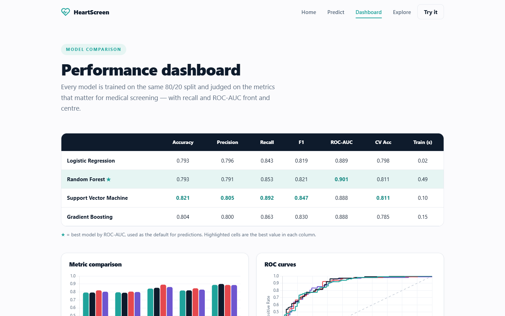

# HeartScreen: Heart Disease Prediction

**Live demo:** <https://crononebula-heartscreen.hf.space>

Compares four scikit-learn classifiers on 920 patient records combined from four UCI databases,
then serves them through a Flask app with a risk form and a model-comparison dashboard. All models
train and run locally, with no external prediction APIs.

> Educational project. Not a medical device, and not for real diagnosis.



## Results

Evaluated on a stratified 80/20 split (736 train, 184 test), with 5-fold cross-validation on the
training set.

| Model | Accuracy | Recall | F1 | ROC-AUC | CV accuracy |
|---|---|---|---|---|---|
| Logistic Regression | 0.793 | 0.843 | 0.819 | 0.889 | 0.798 |
| **Random Forest** | 0.793 | 0.853 | 0.821 | **0.901** | 0.811 |
| Support Vector Machine | **0.821** | **0.892** | **0.847** | 0.888 | 0.811 |
| Gradient Boosting | 0.804 | 0.863 | 0.830 | 0.888 | 0.785 |

Random Forest is the default because it ranks cases best by ROC-AUC. SVM has better recall, which
matters in screening, so the choice depends on the decision threshold. Models use fixed
hyperparameters, so a proper search is the obvious next improvement.

---

## Project structure

```
heartscreen/
├── web/                    # MODERN FLASK APP (primary)
│   ├── server.py           #   Flask routes + JSON API (loads the trained models)
│   ├── templates/          #   base, index, predict, dashboard, explore (Jinja2)
│   └── static/             #   css/styles.css, js/*.js, vendor/chart.umd.min.js
├── app.py                  # Streamlit app (backup UI)
├── run.bat                 # One-click launcher for the Flask app
├── run_streamlit.bat       # Launcher for the Streamlit backup
├── requirements.txt
├── data/
│   ├── heart.csv           # Combined, cleaned dataset (920 records)
│   └── _processed.*.data   # Original raw UCI files
├── src/
│   ├── build_dataset.py    # Combine + clean the 4 UCI databases -> heart.csv
│   ├── preprocess.py       # Feature metadata + sklearn preprocessing pipeline
│   ├── train.py            # Train 4 models, evaluate, save models + metrics
│   └── make_figures.py     # Render report figures into assets/
├── models/                 # Trained model pipelines (.joblib)
├── reports/metrics.json    # All metrics consumed by the dashboards
├── assets/                 # PNG figures for the report
└── docs/                   # Proposal, report, technical doc & viva guide (.docx)
```

---

## 🚀 Quick start (Windows)

The project was developed with **Python 3.12**.

**Option A: one click (Flask app):**
```bat
run.bat
```
Then open <http://localhost:5000>.

**Option B: manual:**
```bat
py -3.12 -m pip install -r requirements.txt
py -3.12 src\build_dataset.py     :: optional, data/heart.csv already included
py -3.12 src\train.py             :: trains models, writes reports/metrics.json
py -3.12 web\server.py            :: launches the Flask web app  (http://localhost:5000)
```

**Backup Streamlit UI:**
```bat
run_streamlit.bat                 :: or:  py -3.12 -m streamlit run app.py
```

---

## 🧠 Models & results

Stratified 80/20 train/test split (736 train / 184 test). Best model chosen by ROC-AUC.

| Model | Accuracy | Precision | Recall | F1 | ROC-AUC | Train time |
|---|---|---|---|---|---|---|
| Logistic Regression | 0.793 | 0.796 | 0.843 | 0.819 | 0.889 | 0.02 s |
| **Random Forest** ⭐ | 0.793 | 0.791 | 0.853 | 0.821 | **0.901** | 0.49 s |
| Support Vector Machine | 0.821 | 0.805 | 0.892 | 0.847 | 0.888 | 0.10 s |
| Gradient Boosting | 0.804 | 0.800 | 0.863 | 0.830 | 0.888 | 0.15 s |

⭐ = best model by ROC-AUC (used as the default in the Predict page).

---

## 📊 Dataset

**UCI Heart Disease Data Set**: combined Cleveland, Hungarian, Switzerland, and
VA Long Beach databases (920 records). Eleven clinical features
(age, sex, chest-pain type, resting blood pressure, cholesterol, fasting blood
sugar, resting ECG, max heart rate, exercise-induced angina, ST depression, ST
slope) predict a binary target (disease present / absent).

Source: <https://archive.ics.uci.edu/dataset/45/heart+disease>

Cleaning: cholesterol/resting-BP values of `0` (meaning "not measured") and `?`
are treated as missing and imputed inside the modelling pipeline (median for
numeric, most-frequent for categorical). The heavily-missing `ca` and `thal`
attributes are dropped.

---

## Documentation (in `docs/`)

| File | Purpose |
|---|---|
| `Project_Proposal.docx` | The project proposal |
| `Project_Report.docx` | The full 8–15 page report (figures + all required sections) |
| `Technical_Documentation.docx` | How the app works: architecture, files, data flow, API |
| `Viva_Preparation_Guide.docx` | Demo script + 30+ viva questions with answers |

The `.docx` files are regenerated from `docs/*.js` with `node docs/<script>.js`.

---

## Reproducibility

All randomness is seeded (`random_state=42`). Re-running `src/train.py` and
`src/make_figures.py` regenerates `reports/metrics.json` and the figures
identically.
